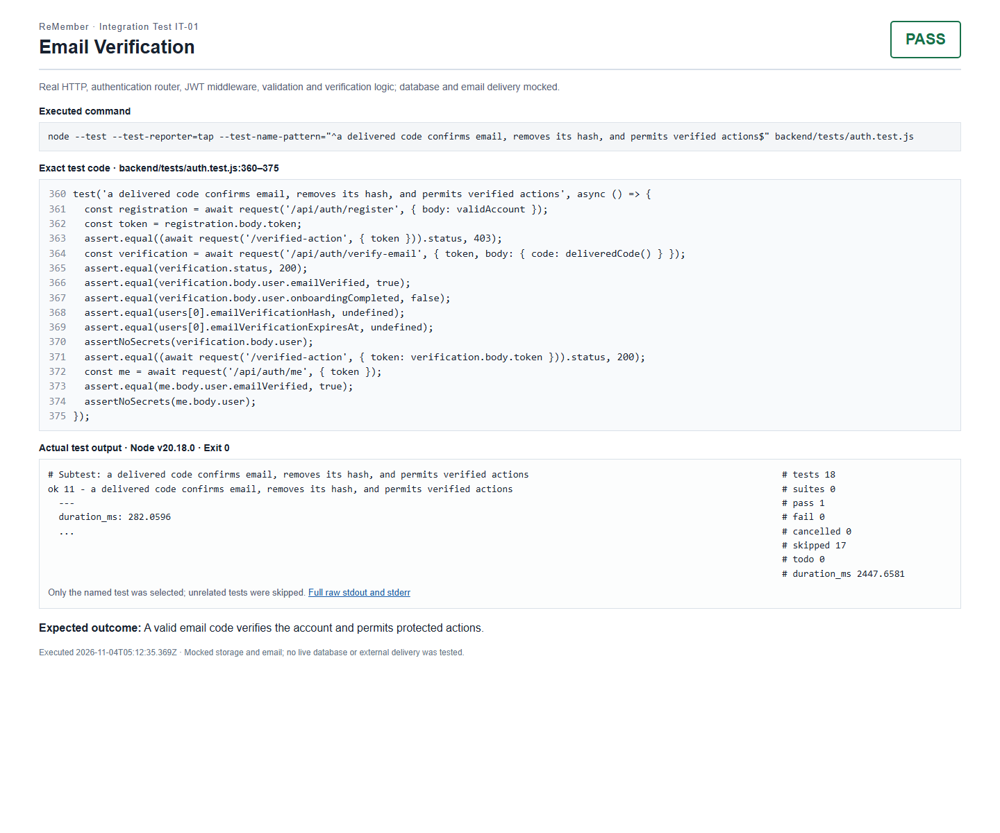
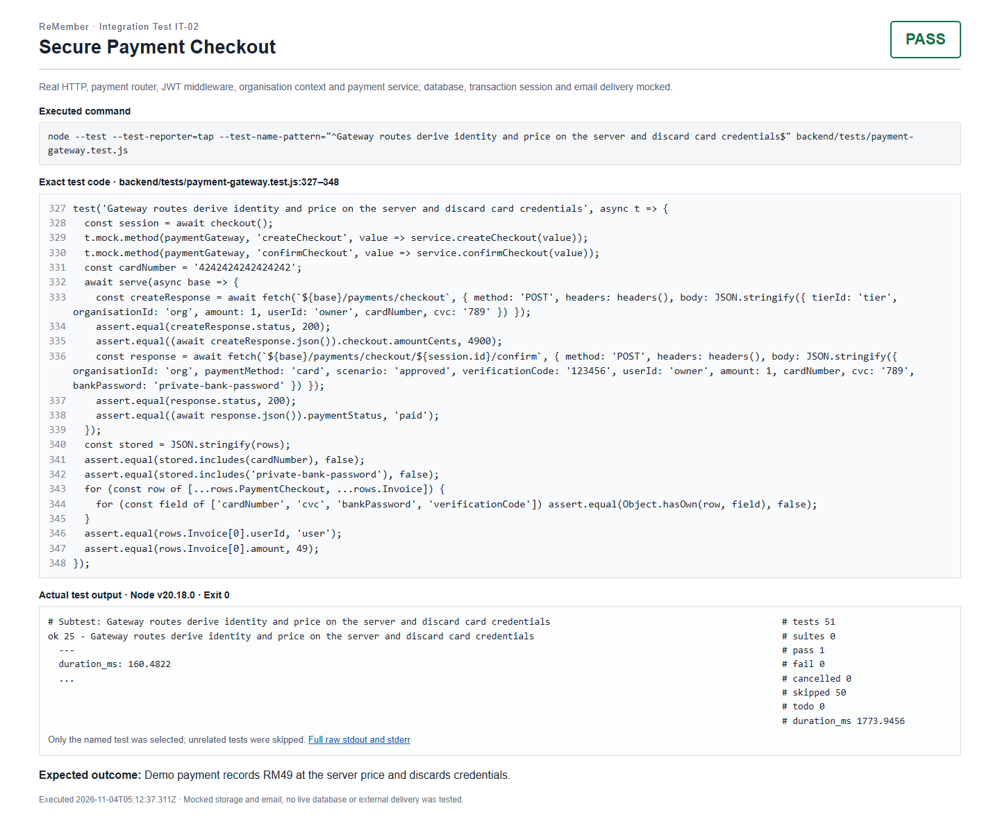
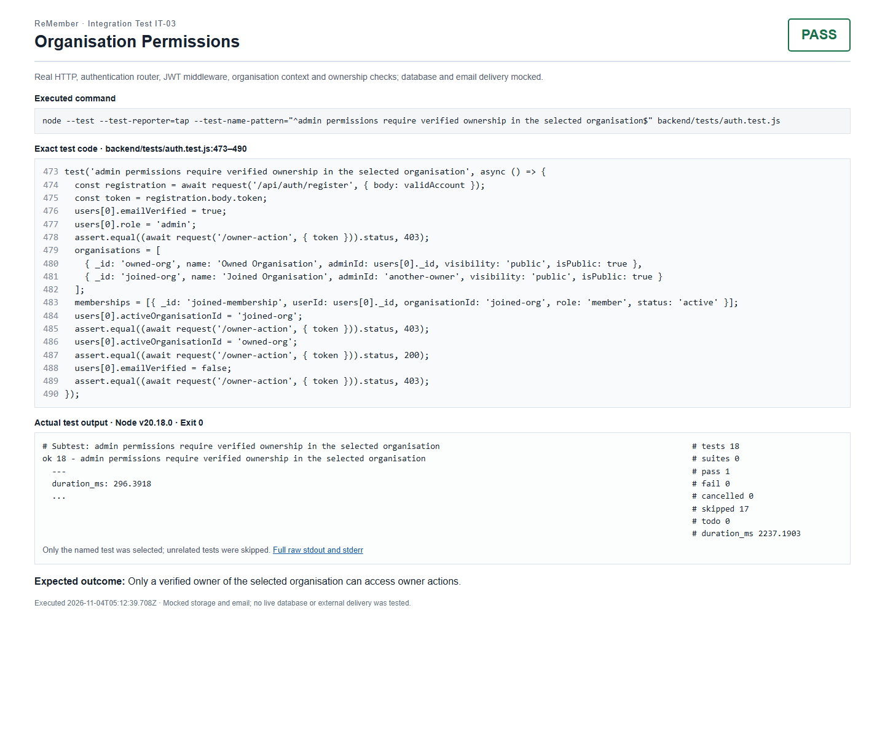

These integration cases were executed with real HTTP requests. Database persistence and email delivery were mocked; the payment case also mocks database transactions. Screenshots show the exact existing test code and captured results.

1. **Test Case Title:** Email Verification
2. **Screenshot of Test + Code:**

   

   [Code](../backend/tests/auth.test.js#L360) · [Evidence page](testing/integration/IT-01.html) · [Raw output](testing/integration/IT-01.txt)

3. **Expected outcome:** A valid email code verifies the account and permits protected actions.
4. **Test Status:** PASS

---

1. **Test Case Title:** Secure Payment Checkout
2. **Screenshot of Test + Code:**

   

   [Code](../backend/tests/payment-gateway.test.js#L327) · [Evidence page](testing/integration/IT-02.html) · [Raw output](testing/integration/IT-02.txt)

3. **Expected outcome:** Demo payment records RM49 at the server price and discards credentials.
4. **Test Status:** PASS

---

1. **Test Case Title:** Organisation Permissions
2. **Screenshot of Test + Code:**

   

   [Code](../backend/tests/auth.test.js#L473) · [Evidence page](testing/integration/IT-03.html) · [Raw output](testing/integration/IT-03.txt)

3. **Expected outcome:** Only a verified owner of the selected organisation can access owner actions.
4. **Test Status:** PASS
