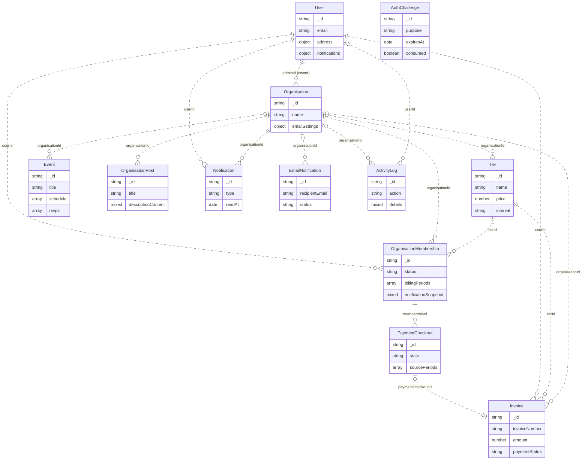
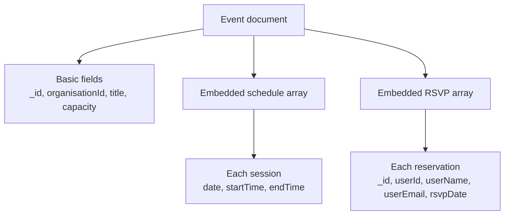

# ReMember MongoDB Data Model Diagram

An ERD can describe a MongoDB database. For this project, use the title **MongoDB Collection Relationship Diagram**: each box represents a collection's document type, connecting lines show references between collections, and fields inside boxes highlight embedded objects and arrays.

MongoDB supports both [embedded data](https://www.mongodb.com/docs/manual/data-modeling/embedding/) and [relationships through document references](https://www.mongodb.com/docs/manual/applications/data-models-relationships/). Showing both makes the diagram useful alongside the [complete field dictionary](MONGODB_DATA_DICTIONARY.md).

## Collection overview

This diagram includes all 12 document types and their principal relationships. It shows selected fields to keep the overview readable. Relationship labels name the field on the referencing document. Cardinalities describe the intended application relationships; references are stored as strings and resolved by application code. Historical records may omit optional references or retain identifiers for deleted documents.

Read `||` as exactly one, `o|` as zero or one, and `o{` as zero or many. Lines represent references between separate collections. Objects and arrays listed inside a collection box belong to that document. `mixed` fields hold flexible structures.

`AuthChallenge` stands alone because it has no stored user or organisation reference. Its identifier connects to a signed authentication token. `EmailNotification` stores a recipient email address; it has no `userId` field. A checkout can produce at most one invoice, while historical invoices may have no checkout reference.

The overview emphasises the main relationships. Additional reference fields include `User.activeOrganisationId`, `OrganisationPost.authorId`, `Event.minimumTierId`, the user/organisation/tier identifiers on checkouts, and the optional `postId`, `eventId`, and `membershipId` on notifications. Embedded RSVP and billing-period records also contain identifiers. The dictionary lists these fields individually.

## Example of an embedded document structure

Use a small document structure diagram when explaining a complex collection. This example expands Event without adding another collection:

Here the arrows mean containment. `schedule[]` and `rsvps[]` are stored inside an Event document; an RSVP's `userId` refers to a separate User document. Similar structure diagrams can expand User profile settings, Organisation email settings, and OrganisationMembership billing periods.

For a report, use the collection overview as the main database diagram and keep the detailed field tables in the data dictionary. Add document structure diagrams for collections whose embedded data needs explanation.

Source: [current Mongoose models](../backend/models/index.js), reviewed on 5 November 2026.
