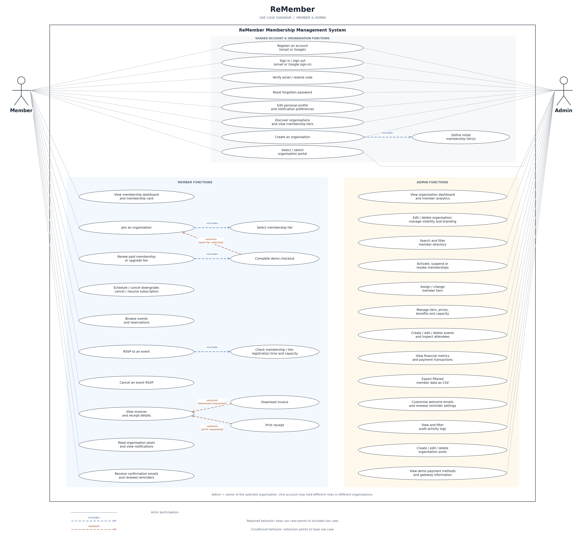

# ReMember use case diagram

The diagram covers the implemented account, organisation, membership, events,
membership card, finance, communication and administration features. It has
exactly two actors: **Member** and **Admin**, with four `«include»` relationships
and three conditional `«extend»` relationships.

Download the [SVG](diagrams/remember-use-case-diagram.svg),
[PDF](diagrams/remember-use-case-diagram.pdf), or
[editable PlantUML source](diagrams/remember-use-case-diagram.puml).

## Actor scope

Admin means the owner of the selected organisation. An account can own one
organisation and be a Member of another. The diagram therefore shows shared
account functions with associations to both actors, without actor inheritance.
Creating an organisation makes its creator the Admin of that organisation.

All organisation-specific permissions, membership records, invoices, events and
email settings belong to the selected organisation. Members need active
membership for events and membership cards; events also enforce tier and capacity
restrictions. Authentication is a precondition for protected functions, rather
than a separate included use case on every line.

## Include and extend relationships

`«include»` represents required behavior. Its dashed arrow points from the base
use case to the included use case. `«extend»` represents conditional behavior;
its dashed arrow points from the extension to the base use case. Conditions are
shown in square brackets. Solid lines indicate actor participation.

| Source use case | Relationship | Target use case | Reason / condition |
| --- | --- | --- | --- |
| Create an organisation | `«include»` | Define initial membership tier(s) | Organisation creation requires at least one active tier. |
| Join an organisation | `«include»` | Select membership tier | Every join requires an available tier. |
| Renew paid membership or upgrade tier | `«include»` | Complete demo checkout | Both actions use checkout to review and confirm the payment or credit. |
| RSVP to an event | `«include»` | Check membership / tier, registration time and capacity | The system validates access and availability before accepting a reservation. |
| Complete demo checkout | `«extend»` | Join an organisation | `[paid tier selected]`: paid joins continue to checkout; free tiers activate immediately. A pending member can return to checkout later. |
| Download invoice | `«extend»` | View invoices and receipt details | `[download requested]`: optionally download the selected invoice as JSON. |
| Print receipt | `«extend»` | View invoices and receipt details | `[print requested]`: optionally print the selected receipt. |

Cancelling an RSVP is a separate later goal, so it has its own Member
association. Scheduling a downgrade does not include checkout: a paid replacement
tier is paid for at the later manual renewal. Email delivery depends on applicable
preferences and settings, so it is not a mandatory included step for every join,
payment or RSVP.

## Use case coverage

| Area | Member | Admin |
| --- | --- | --- |
| Account | Register with email or Google; verify email; sign in/out; reset password; edit profile and notification preferences | Same account functions |
| Organisation access | Discover organisations and tiers; create an organisation; select or switch portal | Same account functions; edit/delete owned organisations; manage visibility, logos and banners |
| Membership | Join an organisation and select a tier; view status and expiry; activate/renew/upgrade through demo checkout; schedule/cancel downgrades; cancel/resume a subscription | Search/filter members; activate, suspend or revoke membership; change a member's tier |
| Tiers | View/select available tiers | Create, edit and delete tiers; configure prices, billing intervals, benefits and capacity |
| Events | Browse events; RSVP; cancel RSVP | Create, edit and delete events; inspect attendee lists |
| Membership card | View a membership card with member details and organisation colour | Member status/tier changes appear when the card is next loaded |
| Billing and reporting | View/download own invoices; print receipts | Dashboard/member analytics; financial metrics and transactions; filtered member CSV exports; audit logs |
| Communication | Read organisation posts and view notifications | Create, edit and delete organisation posts |
| Demo gateway | Use demo checkout for paid membership actions | View supported demo payment methods and gateway information |
| Emails | Receive welcome, renewal, payment and RSVP emails, subject to applicable preferences/settings | Customise and preview welcome/renewal subjects and messages; enable/disable emails; choose renewal lead time |

Welcome emails are attempted on first membership activation: immediately after a
free-tier join or after the first successful paid-tier checkout. Renewal
reminders run automatically **X days before membership expiry**, with a
configurable lead time of 1–365 days. The Automated Email Center has been removed
from the website, so it is not a use case in this diagram.

The checkout currently simulates payment. The diagram does not add a real payment
gateway, event ticket purchases, invitation/code joining, account deletion or
self-service leaving of organisations, because those flows are not implemented.

## Implementation references

- [Navigation and portal features](../frontend/src/components/Sidebar.jsx)
- [Account and organisation flow](../backend/ACCOUNT_FLOW.md)
- [Organisation routes and ownership checks](../backend/routes/organisations.js)
- [Admin member management, exports and reporting](../backend/routes/admin.js)
- [Membership dashboard, profile, passes and invoices](../backend/routes/members.js)
- [Payments and activation](../backend/routes/payments.js)
- [Events and RSVPs](../backend/routes/events.js)
- [Subscription changes and checkout navigation](../frontend/src/pages/member/MembershipPage.jsx)
- [Invoice downloads](../frontend/src/pages/member/InvoicesPage.jsx)
- [Receipt printing](../frontend/src/components/InvoiceModal.jsx)
- [Organisation posts](../backend/routes/posts.js)
- [Notifications](../backend/routes/notifications.js)
- [Welcome email dispatch](../backend/services/organisationEmailSettings.js)
- [Renewal reminder scheduling](../backend/services/renewalScheduler.js)

## Regenerate exports

Run `python docs/diagrams/generate_use_case_diagram.py` from the project root with
Matplotlib installed. The generator's use cases, actor associations and
relationship definitions drive all four exports; the SVG retains editable text.
The diagram is an overview: related user actions are grouped within a single
ellipse to keep the whole project readable. Open the PDF or SVG to zoom in on
the full system diagram without losing clarity.
