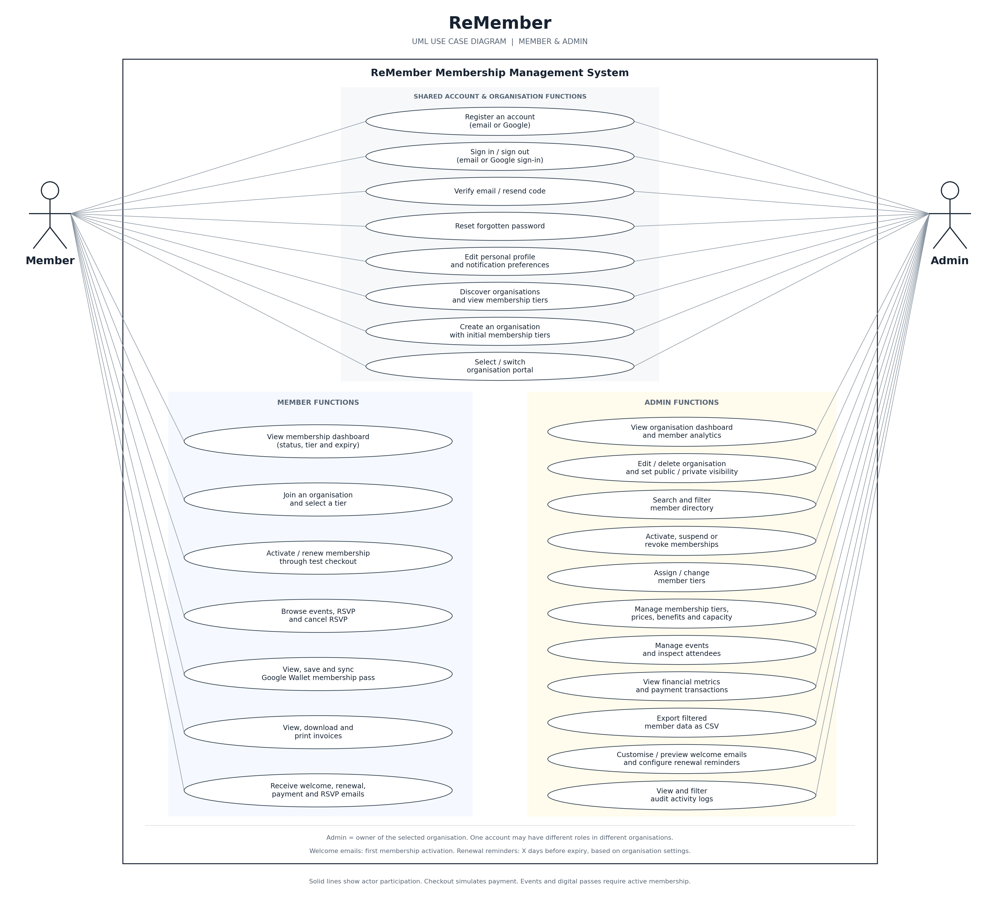

# ReMember use case diagram

The diagram covers the implemented account, organisation, membership, events,
digital pass, finance, email and administration features. It has exactly two
actors: **Member** and **Admin**.

Download the [SVG](diagrams/remember-use-case-diagram.svg),
[PDF](diagrams/remember-use-case-diagram.pdf), or
[editable PlantUML source](diagrams/remember-use-case-diagram.puml).

## Actor scope

Admin means the owner of the selected organisation. An account can own one
organisation and be a Member of another. The diagram therefore shows shared
account functions with associations to both actors, without actor inheritance.
Creating an organisation makes its creator the Admin of that organisation.

All organisation-specific permissions, membership records, invoices, events and
email settings belong to the selected organisation. Members need active
membership for events and digital passes; events also enforce tier and capacity
restrictions. Authentication is a precondition for protected functions, rather
than a separate included use case on every line.

## Use case coverage

| Area | Member | Admin |
| --- | --- | --- |
| Account | Register with email or Google; verify email; sign in/out; reset password; edit profile and notification preferences | Same account functions |
| Organisation access | Discover organisations and tiers; create an organisation; select or switch portal | Same account functions; edit/delete owned organisations; manage visibility, logos and banners |
| Membership | Join an organisation and select a tier; view membership status and expiry; activate/renew through test checkout | Search/filter members; activate, suspend or revoke membership; change a member's tier |
| Tiers | View/select available tiers | Create, edit and delete tiers; configure prices, billing intervals, benefits and capacity |
| Events | Browse events; RSVP; cancel RSVP | Create, edit and delete events; inspect attendee lists |
| Digital passes | View, save and synchronise a Google Wallet membership pass | Member status/tier changes trigger pass updates |
| Billing and reporting | View/download own invoices; print receipts | Dashboard/member analytics; financial metrics and transactions; filtered member CSV exports; audit logs |
| Emails | Receive welcome, renewal, payment and RSVP emails, subject to applicable preferences/settings | Customise and preview welcome/renewal subjects and messages; enable/disable emails; choose renewal lead time |

Welcome emails are attempted on first membership activation: immediately after a
free-tier join or after the first successful paid-tier checkout. Renewal
reminders run automatically **X days before membership expiry**, with a
configurable lead time of 1–365 days. The Automated Email Center has been removed
from the website, so it is not a use case in this diagram.

The checkout currently simulates payment. The diagram does not add a real payment
gateway, event ticket purchases, invitation/code joining, account deletion or
self-service leaving of organisations, because those flows are not implemented.

## Implementation references

- [Navigation and portal features](../frontend/src/components/Sidebar.jsx)
- [Account and organisation flow](../backend/ACCOUNT_FLOW.md)
- [Organisation routes and ownership checks](../backend/routes/organisations.js)
- [Admin member management, exports and reporting](../backend/routes/admin.js)
- [Membership dashboard, profile, passes and invoices](../backend/routes/members.js)
- [Payments and activation](../backend/routes/payments.js)
- [Events and RSVPs](../backend/routes/events.js)
- [Welcome email dispatch](../backend/services/organisationEmailSettings.js)
- [Renewal reminder scheduling](../backend/services/renewalScheduler.js)

## Regenerate exports

Run `python docs/diagrams/generate_use_case_diagram.py` from the project root with
Matplotlib installed. The generator's use case lists drive all four exports;
the SVG retains editable text. The diagram is an overview: related user actions
are grouped within a single ellipse to keep the whole project readable.
